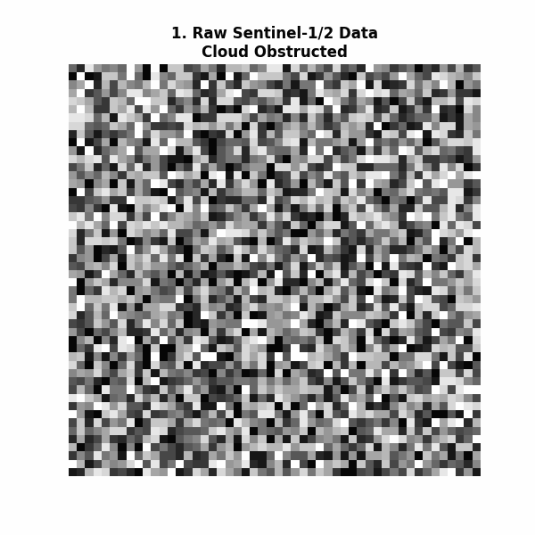
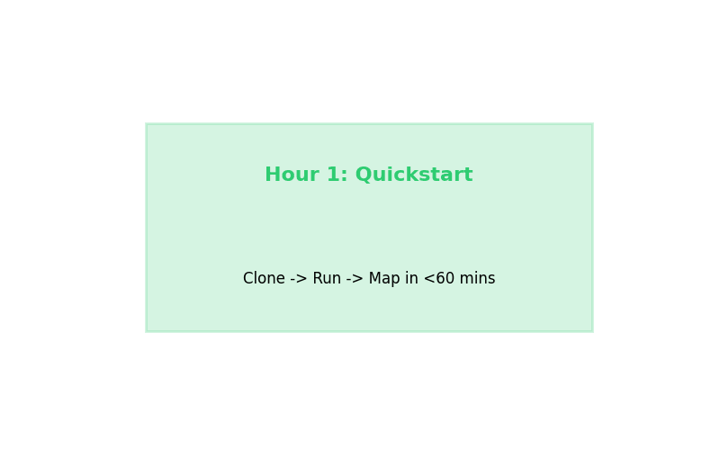

# 🌲 Forest Carbon Continuity Pipeline
**A Sentinel-1/2 Hybrid Approach for EU LULUCF Compliance — One Engine. Multiple Climates.**  
*Built for cloud-proof, species-specific, and reproducible carbon accounting.*

## 🤝 Handover & Onboarding Philosophy
*"If I leave tomorrow, what survives me?"*  
This repository is designed for **< 4 Hour Time-to-Productivity** for any new analyst. No "it works on my machine" excuses.
- **Self-Documenting:** Numbered scripts make execution order obvious.
- **Containerized:** Docker + Conda locks dependencies globally (zero version drift).
- **Fail-Loud:** Bad data never silently drops; it routes to `/quarantine/` with structured JSON diagnostics.
- **Deterministic Replay:** Every output GeoTIFF embeds the `PROVENANCE_COMMIT_SHA` and `INPUT_HASH` for an immutable audit trail.
- **Verified:** `pytest` gate suite + end-to-end synthetic replay executed before handover — see `docs/VERIFICATION_LOG.md`.

## 🚀 Quick Start (Hour 1)
1. **Setup:** `conda env create -f environment.yaml` (or `docker compose up`)
2. **Activate:** `conda activate forest-carbon-continuity`
3. **Run:** Open `notebooks/00_Smart_Upload_Preview.ipynb`, upload the bundled sample `data/sample_nfi.csv`, and see the data validated end-to-end.

## 🏗️ Architecture
- **`src/`**: Core modular Python logic (The Engine)
- **`notebooks/`**: Interactive Colab Wrappers with Smart Uploads & Previews
- **`configs/`**: Region-specific YAML (Ireland, UK, Scandinavia)
- **`data/`**: Bundled sample NFI plot data (`sample_nfi.csv`) + runtime inputs/outputs
- **`tests/`**: Automated guardrails (imports, CRS contract, provenance, quarantine)
- **`docs/`**: "Code as Documentation", Verification Log & Detailed Onboarding Path

## 📊 Pipeline Phases
1. **CRS Reprojection:** WGS84 $\rightarrow$ ETRS89/UTM 29N (EPSG:25829)
2. **Cloud-Proof Masking:** Sentinel-1 VH/VV radar fusion.
3. **NFI Integration:** Relascope/Laser Hypsometer math ($H = D \times \tan(\theta) + h$).
4. **ML Classification:** U-Net (Dice+BCE Loss) for Sitka Spruce, Lodgepole Pine, Native Mixed.
5. **Carbon Accounting:** Species $\times$ Age Matrix with $\pm 95\%$ CI uncertainty.
6. **Density & LULC Layers:** VDF, MDF, Open Forest, Nurseries, Barren Land mapping.

---
*Built by Syed Rafi Ahmed | M.Tech Remote Sensing & GIS*  
*Contact: alsyedrafiahmed@gmail.com | +919260992822*
